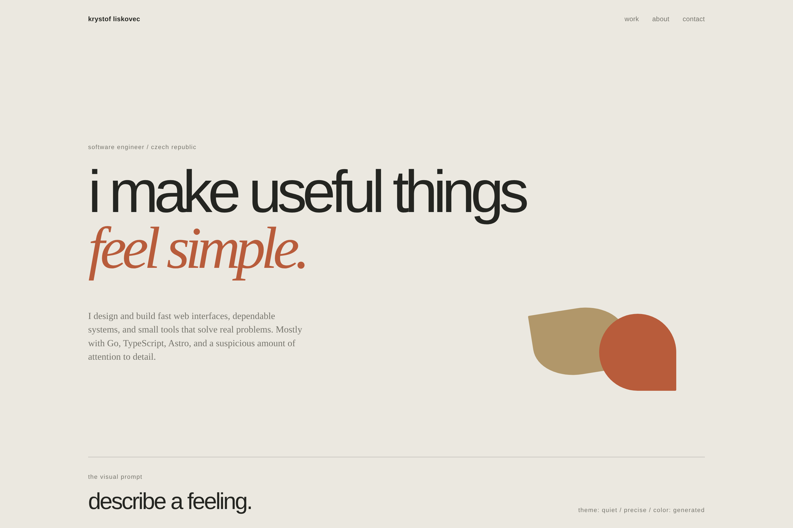
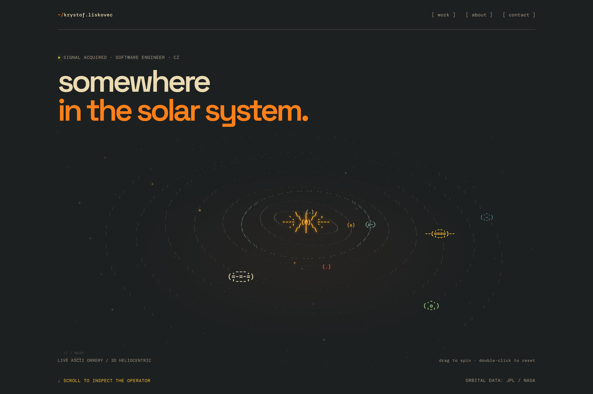
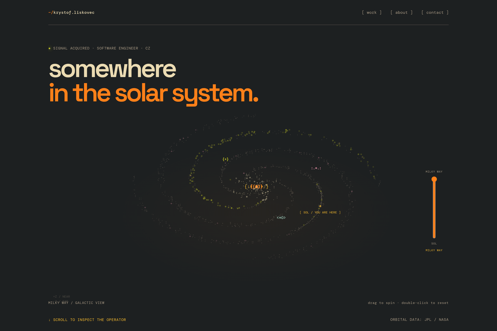
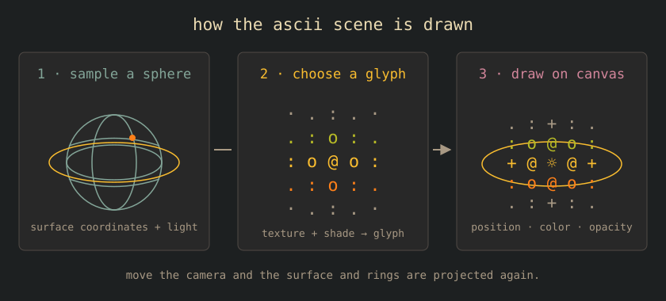
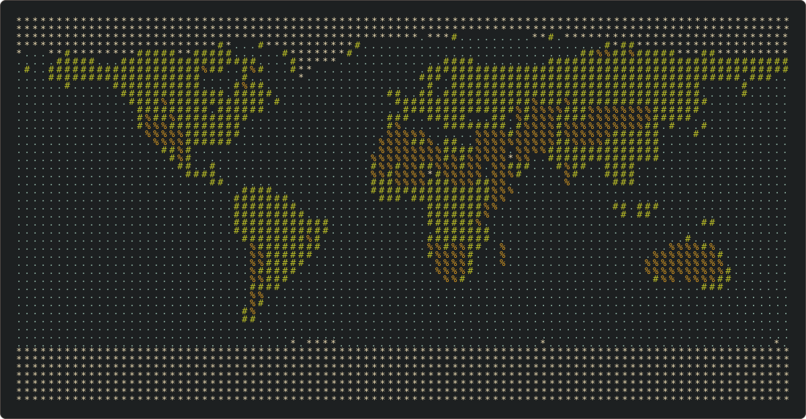
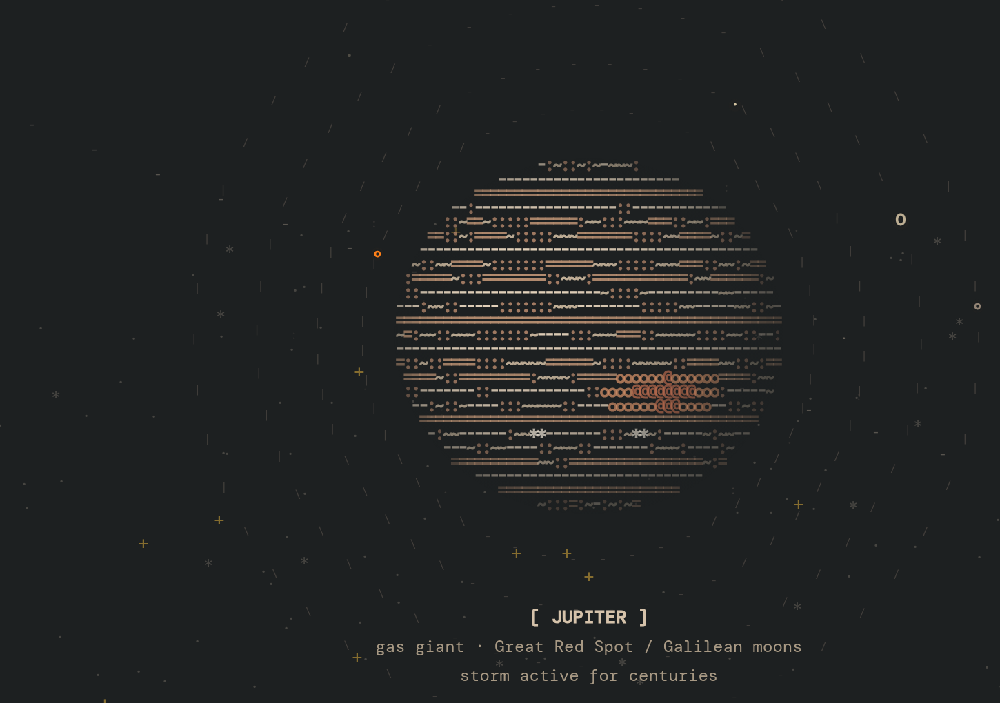
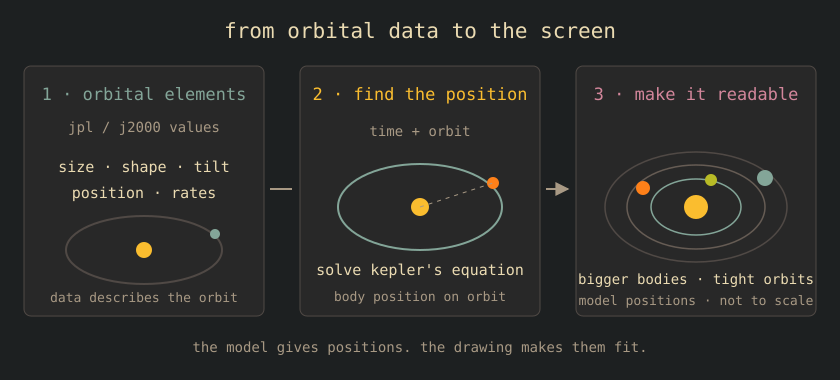
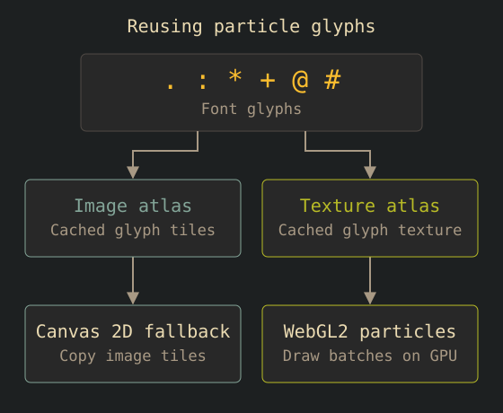
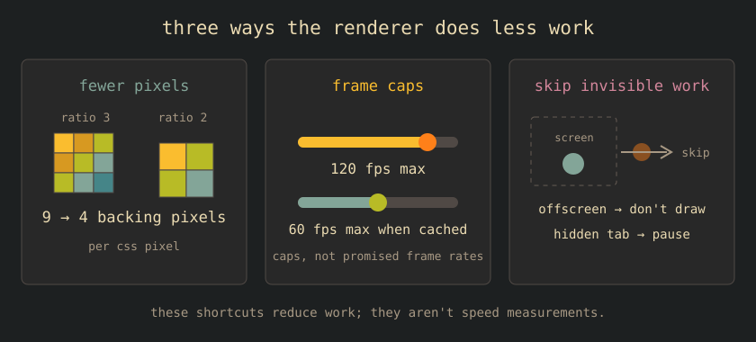

this post is about how i created my own small universe on the internet. i wanted my portfolio to feel alive and
interactive, with visuals resembling a terminal and showing more of my personality than with a standard page. finding
the right direction took a few experiments, and the first one looked quite different from what i have now.

## a changing page theme experiment

before the orrery, i tried a prompt input that changed the page's style. you could describe a mood or a scene and it
would try to make a matching theme. my first thought was to put a language model right in the browser to figure out what
the prompt meant. i tried one that compared your words with descriptions of themes and visual styles. it worked, but
loading it into the page used a lot of memory for something as small as changing the colours.

another approach was to keep a set of predefined colour palettes and use a small embedded model to choose the closest
match for the prompt. i also tried matching words like “forest” or “blue” directly to a palette. that only worked for a
short list of words, but it was another way to solve the same theme-selection problem. even so, the page still felt
heavy and slow. i could have used lazy loading for the model, but it would have added unnecessary waiting, especially
for someone on a slow connection. i wanted people to be able to interact with the page as soon as possible.

_the prompt sat just below the headline, with theme controls and examples underneath._

## the portfolio in space

i wanted to keep the page as small as possible for fast loading, so i eventually scrapped the dynamic theme idea. around
then, i was playing a lot of stellaris, and it sparked a new direction for the portfolio: build a space scene visitors
could explore.

the ascii idea came after. the main particle lists contain around 1,300 particles for the solar-system background and
around 4,900 for the galaxy. not all of them are on screen at once, since the page skips particles outside the view, but
every visible character needs a position, color, shade, and draw order. character cells aren't square either, so their
spacing has to be adjusted to make the planets look round. drawing the same glyphs over and over also got expensive,
which led to the atlas and webgl particle path later on.

i started with the solar system. i'm a big fan of the gruvbox theme and put it anywhere i can, so its colors felt like a
natural fit for the ascii style.

_the orrery arrived. at first it showed the solar system, with planets you could drag around._

over time, the page gained a galaxy view, close-ups, shaded planets, and moons. saturn's rings had to use the same
camera projection as the planet, or they shifted out of place as the camera moved. pluto became an easter egg, at first
unlocked by clicking nine times quickly.

_the zoom slider is pulled back toward the milky way, with the original solar-system view getting smaller._

## how the animation is drawn

the orrery is drawn on canvas, rebuilding the scene character by character on each frame. each character gets a
position, color, transparency, and draw order.

for a planet, the renderer uses a grid of characters to draw a sphere. the coordinates pick the texture and character,
and shading makes it look round. changing the coordinates makes the planet rotate.

the planet looks different depending on how close you are. from far away, it uses a simpler version. up close, it gets
more characters and surface detail. there's no point calculating lots of detail if it only takes up a few pixels on
screen.

the galaxy is drawn on a character grid too. zoomed in, it shows glowing clouds and star clusters, groups of stars
gathered together by gravity. sagittarius a* is the black hole at the milky way's center: a region where gravity is so
strong that light can't escape. its bright disk suggests hot gas around it, and the bent arcs hint at light bending
around the black hole. the wide view uses small glyphs for distant stars and other objects.

separate renderers handle different objects, so each planet or moon can be tuned without digging through all the galaxy
code. a shared scene loop combines them on each frame.

## close-ups of the planets

the first detailed zoom was a separate earth scene, with a rotating ascii globe, the moon, and the international space
station (iss) nearby. earth was tricky to draw with patterns alone because its continents are so recognizable that an
all-generated surface looked too abstract to read as earth. the close-up uses a small ascii sprite map for the land,
with generated clouds layered over it. later, the page switched to a click-to-focus view that could follow any planet.
getting that transition to feel like one scene took some work: the solar-system view had to recede while the selected
planet grew, its surface needed more glyph detail and shading, and the moon positions had to follow the same camera
change. later, the focused view also grew to cover jupiter and its four largest moons.

the renderer builds each close-up surface from rules as it draws instead of loading a finished texture image. this is
called procedural generation. it samples longitude and latitude across the sphere, uses those coordinates to make a
pattern, then chooses a character and color for each point. because the pattern is tied to the sphere's coordinates, it
stays in place as the planet turns. jupiter gets bands and the great red spot, a huge storm in its atmosphere. venus
gets flowing cloud patterns, and mercury gets craters placed by the code. the patterns are stylized, but each planet
gets a distinct surface without needing a large image file.

_the map gives earth its land shapes. the renderer adds generated clouds when it draws the globe._

_the jupiter focus view, with its four major moons._

## getting the motion from the data

orbital data determines where the planets should be as time moves forward.

the planets use orbital elements (numbers that describe an orbit) and rates from jpl's approximate planetary positions.
jpl is nasa's jet propulsion laboratory. j2000 is the shared reference point for those numbers, around noon on january
1, 2000. the page moves each planet forward from there using its rate. kepler's equation is the bit of orbit math that
turns that progress into a position along the planet's oval path. the big moons use orbital elements too.

the milky way's spiral arms are long curved patterns in its disk. their paths in the page come from published fits:
curves researchers adjusted to match observations of stars and gas. for named objects, the page uses catalogues, lists
of objects measured by astronomers, to get their directions in the sky and estimated distances from us.

the planets orbit, spin, and move with the galaxy at very different speeds. each motion has its own clock, so speeding
up a planet's rotation doesn't also speed up its orbit.

the picture uses some real numbers, but it isn't to scale. the planets are larger and their orbits are compressed, since
at real scale most of the screen would be empty and the planets would be tiny dots. the galaxy model is simplified too,
and speeding it up doesn't predict what it will look like in a million years.

## keeping the animation moving

as the scene grew, keeping the planets turning while the camera moved and making the zoom from the solar system to the
galaxy feel smooth became harder. each new detail added more drawing per frame, and the controls needed to work on
phones too.

once particle fields, detailed planets, and the galaxy were on screen, the next step was finding work the renderer could
reuse instead of repeating every frame.

### reusing characters

the particles reuse a small set of characters: dots, stars, and plus signs. at first the canvas drew every character
from scratch. a glyph atlas is a bit like a game's texture atlas: it keeps a sheet of ready-to-draw pieces so the
renderer can reuse one when it needs it. here those pieces are individual characters. the canvas 2d version builds that
sheet in an offscreen canvas, with separate copies for different fonts, colors, and pixel ratios. it copies the tile it
needs instead of drawing the same glyph again. if a character isn't in the atlas, it falls back to normal text drawing.

the webgl path uses the same idea, with its atlas stored as a gpu texture. instanced drawing lets it draw a whole batch
at once. some of the movement and projection calculations run in shaders too, so javascript has less to do for each
particle.

_canvas 2d and webgl each have their own atlas. canvas 2d is also the fallback and draws the rest of the artwork and
readouts._

i also considered moving some of the renderer to webassembly. it can help with number crunching, but it wouldn't make
the browser's canvas drawing calls faster by itself. the code would still need to send the characters to the canvas.
here, reusing glyphs and drawing particle batches with webgl addressed the repeated work more directly. a webassembly
version would add another layer to maintain without a clear calculation that needed it.

### performance optimization

the canvas pixel ratio is capped at 2. it controls how many canvas pixels are drawn for each css pixel in both width and
height. at a ratio of 2, a one-by-one css pixel area gets a 2-by-2 block of canvas pixels, four in total. at a device
pixel ratio of 3, drawing at full resolution would use nine pixels for that same area, so the cap uses about 56% fewer.
at a device pixel ratio of 4, it uses four instead of sixteen, or 75% fewer. the canvas still appears at the same size
on screen, so the browser scales it up. this reduces drawing work but can make fine details a little softer. those are
pixel-count reductions, not page-speed improvements.

the whole scene can render up to 120 frames per second. when the view is fully zoomed out to the milky way and the
camera isn't being dragged or reset, the page draws the large galaxy layer onto a separate canvas kept out of sight. it
copies that saved picture into each new frame and refreshes it at most 60 times a second, instead of rebuilding
thousands of galaxy characters every time.

that is 50% fewer possible galaxy redraws than drawing the layer on every frame at the 120 fps ceiling. when you zoom
back in or drag the camera, the saved picture is no longer used so the galaxy can move with the view. these are upper
limits. actual rates vary with the device and scene. drawing also stops when the scene is offscreen or the browser tab
is hidden.

a few early exits skip work too. if a small planet has faded away, there's no reason to work out its surface. if a
planet and its rings are offscreen, there's no reason to draw them.

together these shortcuts reduce canvas work: fewer pixels to fill, fewer background updates, and no rendering for
objects outside the view.

### starting the scene

the animation takes time to load, so its renderers start at different times. the page waits until the heading appears
before starting the orrery, loads the galaxy and close-up renderers when you zoom to them, and starts webgl when the
browser is idle or you interact.

## getting it working on phones

making the orbits smaller on a phone wasn't enough. the planets, characters, labels, and masks that put nearer objects
in front all needed to scale down too. fullscreen also had to account for screen rotation and safe areas around the
edges.

for touch controls, the page picks the object when you lift your finger. your finger can cover the object while you're
touching the screen, and a drag can end somewhere different from where it started.

the page supports keyboard controls for moving the camera, picking objects, zooming, and leaving a close-up. the
animation also follows the reduced-motion setting. since the canvas objects aren't real buttons, the page provides
labels and instructions for the controls.

the ascii look seemed like it would make animation easier. instead, getting the characters to move together pulled me
into projection, orbital movement, rendering performance, and touch controls. by the end, the project had grown far
beyond the theme experiment, and taught me more about building interactive visuals for the web than i expected. it feels
a lot more like my kind of portfolio now.

## sources

- [jpl: approximate positions of the planets](https://ssd.jpl.nasa.gov/planets/approx_pos.html) - orbital elements,
  rates, and the method used to calculate planetary positions.
- [jpl: planetary satellite mean elements](https://ssd.jpl.nasa.gov/sats/elem/) - orbital elements for the moons.
- [reid et al. (2019): our view of the milky way](https://arxiv.org/abs/1910.03357) - the spiral-arm fits used as a
  starting point for the galaxy view.
- [nasa: the great red spot](https://www.nasa.gov/solar-system/planets/jupiter/the-great-red-spot/) - background on
  jupiter's storm.
- [nasa: what is the center of our galaxy like?](https://science.nasa.gov/mission/webb/science-overview/science-explainers/what-is-the-center-of-our-galaxy-like/) -
  background on sagittarius a* and the galactic center.
- [mdn: webassembly concepts](https://developer.mozilla.org/en-US/docs/WebAssembly/Guides/Concepts) - how webassembly
  works alongside browser APIs.
